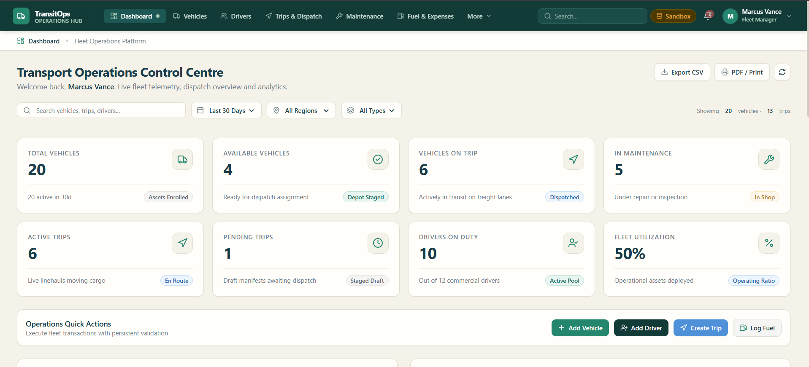

# 🚍 TransitOps — Smart Transport Operations Platform

A modern Smart Transport Operations Platform designed to help organizations manage fleet vehicles, drivers, trip dispatch, vehicle maintenance, fuel expenses, and operational performance through a centralized dashboard.

---

## 🚀 Live Demo

🔗 [TransitOps — Live Project](https://transit-ops-one-zeta.vercel.app/)

---

## 📸 Dashboard Preview



*The TransitOps dashboard provides a centralized overview of fleet status, vehicle availability, trips, and transport operations.*

---

## ✨ Features

- 📊 Interactive Transport Operations Dashboard
- 🚚 Fleet and Vehicle Management
- 👥 Driver Management
- 🛣️ Trip Planning and Dispatch
- 🔧 Vehicle Maintenance Tracking
- ⛽ Fuel and Expense Management
- 📈 Operational Reports and Analytics
- 📉 Fleet Status Monitoring
- 🔍 Organized Navigation and Search
- 📱 Responsive User Interface
- ☁️ Supabase Database Integration

---

## 🛠 Tech Stack

- Next.js
- React
- TypeScript
- Tailwind CSS
- Supabase
- PostgreSQL
- Recharts
- Vercel

---

## ⚙️ Installation

### 1. Clone Repository

```bash
git clone YOUR_REPOSITORY_URL
```

### 2. Navigate to Project

```bash
cd TransitOps
```

### 3. Install Dependencies

```bash
npm install
```

### 4. Configure Environment Variables

Create a `.env.local` file in the project root:

```env
NEXT_PUBLIC_SUPABASE_URL=your_supabase_project_url
NEXT_PUBLIC_SUPABASE_PUBLISHABLE_KEY=your_supabase_publishable_key
```

Use the exact environment variable names referenced in your source code. Never expose secret or service-role keys in public repositories.

### 5. Run Locally

```bash
npm run dev
```

Open http://localhost:3000 in your browser.

---

## 🎯 Use Case

TransitOps aims to help organizations:

- Monitor vehicle availability and fleet status.
- Organize driver and trip information.
- Track maintenance activities and fuel expenses.
- Visualize key operational metrics.
- Improve transport planning and operational efficiency.

---

## 🚀 Future Improvements

- 📍 Real-Time GPS Vehicle Tracking
- 🗺️ Smart Route Optimization
- 🔔 Automated Maintenance Alerts
- 📊 Advanced Analytics and Report Export
- ⛽ Fuel Consumption Analysis
- 📱 Dedicated Mobile Interface for Drivers
- 🔐 Enhanced Role-Based Access Control

---

## 👩‍💻 Author

**Adarsh Atulya**

GitHub: [https://github.com/aadarshatulya297-sudo](https://github.com/aadarshatulya297-sudo)

---

*Smarter journeys. Better operations.*
